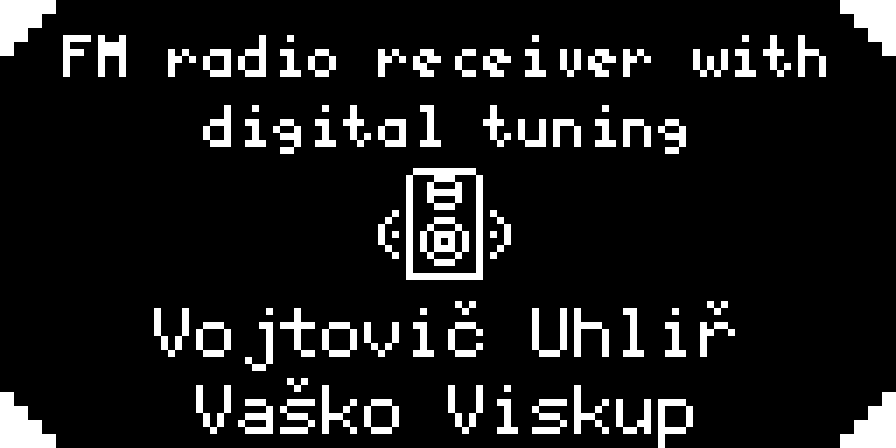
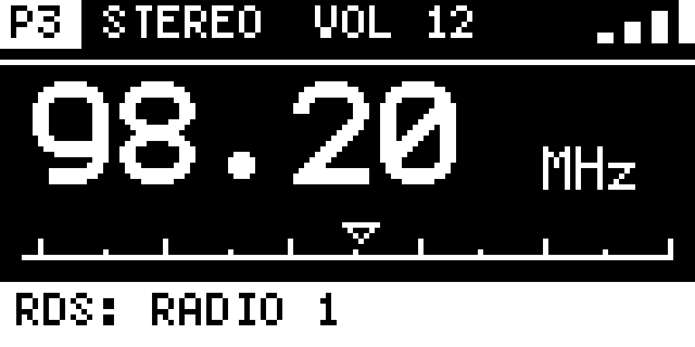
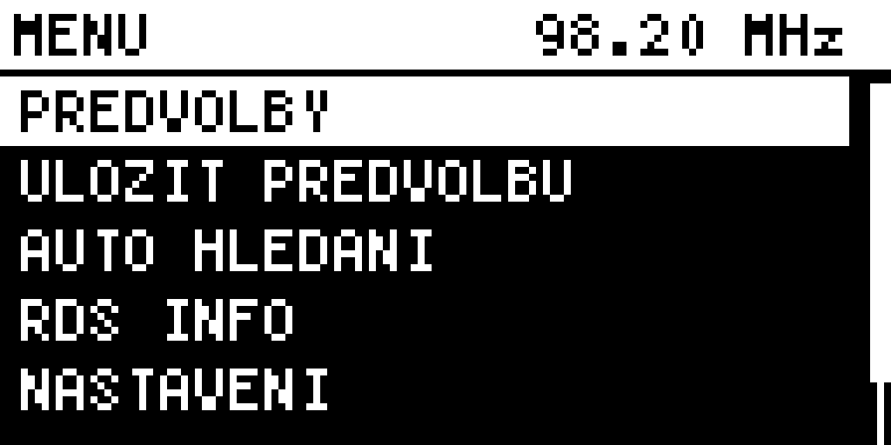
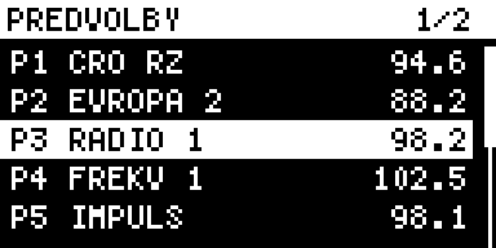
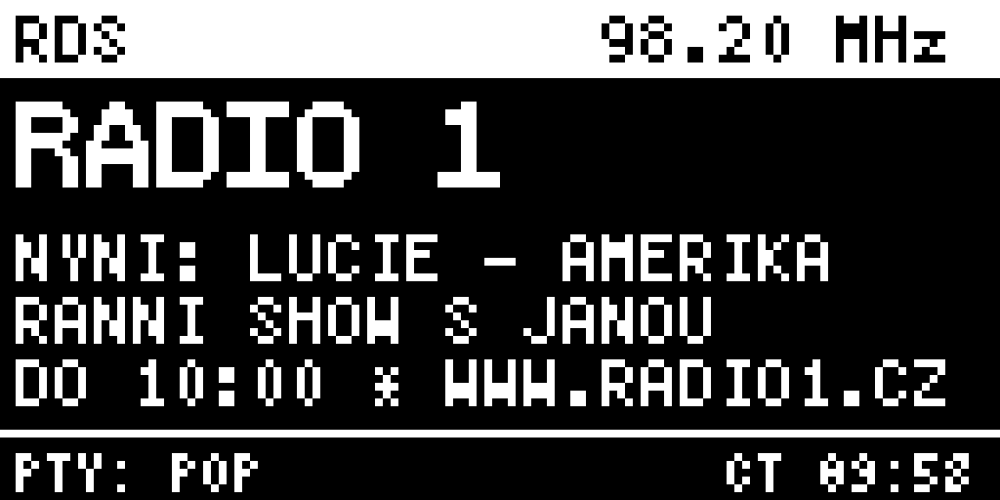
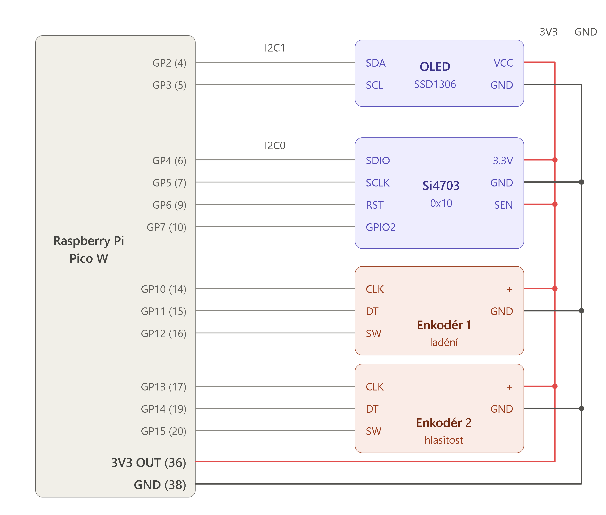

# DE2_FM_RADIO_5

FM radio receiver with digital tuning. Project for DE2 course

## Zadání

> **5. FM radio receiver with digital tuning** – I2C FM tuner module, rotary encoder,
> Nokia SPI or serial 4-digit display. Tune frequency using the encoder and display the
> selected frequency. Route the tuner's audio output to suitable headphones or a powered
> amplifier; do not drive a speaker from a Pico GPIO. Save presets, add button-controlled
> station selection, or show RDS text if the particular tuner module supports RDS.

| Požadavek zadání                                     | Řešení v projektu                                                                          |
| ---------------------------------------------------- | ------------------------------------------------------------------------------------------ |
| I2C FM tuner                                         | Si4703 (I2C, adresa 0x10)                                                                  |
| Rotační enkodér                                      | 2× KY-040 – ladění a hlasitost                                                             |
| Displej (Nokia SPI / 4-digit)                        | 1,3" OLED SH1106 128×64 přes I2C – větší rozlišení umožní zobrazit i RDS, RSSI a předvolby |
| Ladění enkodérem + zobrazení frekvence               | enkodér 1, hlavní obrazovka FM se stupnicí                                                 |
| Audio do sluchátek / aktivního zesilovače, ne z GPIO | výstup z 3,5mm jacku modulu Si4703 do sluchátek, Pico audio nevede                         |
| Rozšíření: předvolby                                 | P1–P9 uložené ve flash                                                                     |
| Rozšíření: výběr stanice tlačítkem                   | stisk enkodéru 1 přepíná předvolby, dlouhý stisk = seek                                    |
| Rozšíření: RDS text                                  | Si4703 RDS podporuje – název stanice (PS) a radiotext                                      |

## Úvod

Cílem projektu je FM rozhlasový přijímač s digitálním laděním postavený na tuneru
**Si4703** a mikrokontroléru **Raspberry Pi Pico W** (RP2040) s firmwarem **MicroPython**.
Uživatelské rozhraní tvoří 1,3" OLED displej 128×64 a dva rotační enkodéry s tlačítkem
(KY-040) – jeden pro ladění, druhý pro hlasitost. Zvuk je vyveden na 3,5mm jack modulu
Si4703, kabel sluchátek zároveň slouží jako anténa.

## Co bude umět / vlastnosti

- příjem FM pásma **87,5–108 MHz**, krok 100 kHz (evropské nastavení Si4703)
- ruční ladění enkodérem 1, **automatické vyhledávání stanic (seek)** dlouhým stiskem
- **hlasitost 0–15** enkodérem 2, stiskem ztlumení (mute)
- **předvolby stanic** (P1–P9) uložené ve flash paměti Pico, přepínání krátkým stiskem enkodéru 1
- dekódování **RDS** – název stanice (PS) a radiotext
- indikace **STEREO/MONO** a síly signálu (**RSSI**, 4 dílky)
- obrazovky: úvodní (splash), hlavní FM se stupnicí, menu, předvolby, RDS – návrhy v [`pic/`](pic/)
- **menu** (předvolby, uložit předvolbu, auto hledání, RDS info, nastavení, zpět) se scrollováním enkodérem

| Splash                        | FM                        | Menu                        |
| ----------------------------- | ------------------------- | --------------------------- |
|  |  |  |

| Předvolby                      | RDS                        |
| ------------------------------ | -------------------------- |
|  |  |

## Členové týmu a role

| Člen            | Role   |
| --------------- | ------ |
| Richard Vaško   | SI4703 drivers |
| Václav Vojtovič | UI     |
| Daniel Viskup   | HW, test FW |
| Vít Uhlíř       | test Display |

## Struktura repozitáře

```
DE2_FM_RADIO_5/
├── README.md                        
├── fm_radio_pico_si4703_schema.png  
├── pic/                             
│   ├── README.md
│   ├── splash_screen_8x.png
│   ├── fm_screen_8x.png
│   ├── menu_screen_8x.png
│   ├── presets_screen_8x.png
│   └── rds_screen_8x.png
└── test/                            
    ├── OLED_test.py                 
    ├── display_test.py              
    ├── encoder_display.py           
    ├── test_dual_enc.py             
    └── test_dual_enc_longpress.py   
```

Knihovny ze sekce [Použité knihovny](#použité-knihovny) se nahrávají do `:lib/` na Pico.

## Schéma zapojení



> **Pozor:** obrázek schématu zatím neodpovídá kódu. Platné zapojení je v tabulce níže
> (OLED je SH1106 na I2C0 společně se Si4703, enkodéry na GP12–GP17). Schéma je potřeba překreslit.

| Pico W pin   | Signál                    | Připojeno k                      |
| ------------ | ------------------------- | -------------------------------- |
| GP4 (6)      | I2C0 SDA                  | OLED SDA, Si4703 SDIO            |
| GP5 (7)      | I2C0 SCL                  | OLED SCL, Si4703 SCLK            |
| GP6 (9)      | RST                       | Si4703 RST                       |
| GP7 (10)     | GPIO2 (přerušení STC/RDS) | Si4703 GPIO2                     |
| GP12 (16)    | SW                        | Enkodér 1 (ladění) – tlačítko    |
| GP13 (17)    | DT                        | Enkodér 1 (ladění)               |
| GP14 (19)    | CLK                       | Enkodér 1 (ladění)               |
| GP15 (20)    | SW                        | Enkodér 2 (hlasitost) – tlačítko |
| GP16 (21)    | DT                        | Enkodér 2 (hlasitost)            |
| GP17 (22)    | CLK                       | Enkodér 2 (hlasitost)            |
| 3V3 OUT (36) | 3,3 V                     | VCC všech modulů, Si4703 SEN     |
| GND (38)     | GND                       | GND všech modulů                 |

I2C adresy: OLED SH1106 `0x3C`, Si4703 `0x10` – sdílí jednu sběrnici.

## BOM (seznam součástek)

| Ks  | Součástka                                   | Poznámka                  |
| --- | ------------------------------------------- | ------------------------- |
| 1   | Raspberry Pi Pico W                         | MCU RP2040, MicroPython   |
| 1   | Modul FM tuneru Si4703 (breakout)           | I2C, výstup na 3,5mm jack |
| 1   | OLED displej 1,3" 128×64, řadič SH1106, I2C | adresa 0x3C               |
| 2   | Rotační enkodér KY-040 s tlačítkem          | ladění, hlasitost         |
| 1   | Sluchátka s 3,5mm jackem                    | kabel slouží jako anténa  |
| 1   | Nepájivé pole + propojovací vodiče          |                           |
| 1   | Kabel USB micro-B                           | napájení a programování   |

## Zamýšlené časování tasků

Program poběží jako kooperativní smyčka (`asyncio`), časově kritické vstupy obsluhují přerušení.

| Task              | Perioda / spouštění         | Popis                                                              |
| ----------------- | --------------------------- | ------------------------------------------------------------------ |
| Enkodéry          | přerušení na hranách CLK/DT | dekódování otáčení (micropython-rotary)                            |
| Tlačítka          | přerušení + debounce 30 ms  | krátký stisk / dlouhý stisk > 1 s                                  |
| Obsluha vstupů    | 20 ms                       | čtení enkodérů, změna frekvence/hlasitosti                         |
| Ladění / seek     | na požadavek                | zápis do Si4703, čekání na STC (GPIO2), typicky desítky ms na krok |
| RDS               | 40 ms                       | čtení RDS registrů (skupina RDS přichází cca každých 88 ms)        |
| RSSI + stereo     | 500 ms                      | čtení stavového registru Si4703                                    |
| Displej           | 100 ms, jen při změně       | překreslení framebufferu a odeslání přes I2C                       |
| Uložení předvoleb | na požadavek                | zápis do flash (ne periodicky – šetří flash)                       |

## Použité knihovny

| Knihovna                                                                                                     | Verze                    | Použití                                                                                  |
| ------------------------------------------------------------------------------------------------------------ | ------------------------ | ---------------------------------------------------------------------------------------- |
| [MicroPython](https://micropython.org/download/RPI_PICO_W/)                                                  | v1.29.0                  | firmware Pico W (`machine`, `framebuf`, `asyncio`)                                       |
| [micropython-rotary](https://github.com/miketeachman/micropython-rotary/) (`rotary.py`, `rotary_irq_rp2.py`) | master, bez vydané verze | čtení enkodérů KY-040                                                                    |
| [SH1106](https://github.com/robert-hh/SH1106) (`sh1106.py`)                                                  | master, bez vydané verze | ovladač OLED displeje                                                                    |
| `gpio_devices.py`                                                                                            | vlastní                  | tlačítko s debounce a detekcí stisku                                                     |
| `u8text.py` + `font_*.py`                                                                                    | vlastní                  | vykreslování textu, fonty převedené z BDF fontů [u8g2](https://github.com/olikraus/u8g2) |
| [Lopaka](https://github.com/sbrin/lopaka)                                                                    | –                        | návrh obrazovek (není na zařízení)                                                       |

---

Resources
---

- [Si4703](https://cdn.sparkfun.com/assets/f/0/9/0/1/Si4702-03-C19-1.pdf)
- [Si4730 AN230](https://cdn.sparkfun.com/datasheets/BreakoutBoards/AN230.pdf)
- [RPi Pico W](https://pip-assets.raspberrypi.com/categories/686-raspberry-pi-pico-w/documents/RP-008312-DS-2-pico-w-datasheet.pdf)
- [RP2040](https://pip-assets.raspberrypi.com/categories/814-rp2040/documents/RP-008371-DS-1-rp2040-datasheet.pdf)
- [KY-040](https://www.handsontec.com/dataspecs/module/Rotary%20Encoder.pdf)

---

Authors: Richard Vaško, Václav Vojtovič, Daniel Viskup, Vít Uhlíř
